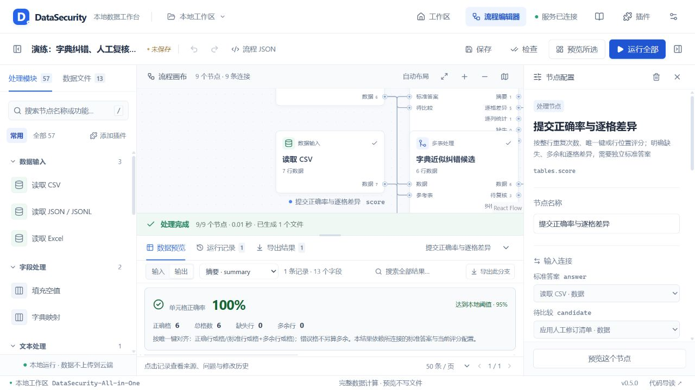

# DataSecurity-All-in-One

**CTF 数据安全处理工作台**


通过可视化节点处理 CTF 数据安全题：导入附件、清洗校验、纠错分析，再导出答案或独立 Python 复现脚本。提供 **56 个内置节点**，支持自己添加 Python 插件。数据在本机处理，无需云端账号。



*图中为自建纠错演练，100% 是样本对比结果，并非赛事官方得分。*

## 主要功能

- **输入与导出**：CSV/TSV、XLSX、JSON/JSONL、文本日志；通过 TShark 提取离线明文 HTTP 请求正文。
- **清洗与校验**：字段整理、正则、身份证与 Luhn 校验、日期处理、筛选、去重和排序。
- **正则助手**：常用模板、中文规则组合、Python 正反例测试，确认后回填节点；无需 grex。
- **纠错与分析**：字典候选、人工修订、关联统计、按行/按格评分，保留来源与修改记录。
- **流程与插件**：流程保存/导入、分支预览、插件模板、源码导入及热加载。
- **WP 复现**：将完整流程导出为独立 `exp.py`，内嵌所需处理源码，无需安装本工具。

## 安装与启动

准备 **Python 3.11+** 和 **Node.js 24 LTS**（兼容 22.18+）。首次安装以 Windows PowerShell 为例：

```powershell
git clone https://github.com/MetaViii/DataSecurity-All-in-One.git
Set-Location DataSecurity-All-in-One

python -m venv .venv
.\.venv\Scripts\Activate.ps1
python -m pip install -r requirements.txt

Set-Location frontend
npm ci
npm run build
Set-Location ..

python -m datasecurity serve
```

打开 **http://127.0.0.1:8765**，停止服务按 `Ctrl+C`。后续在项目根目录激活虚拟环境后，直接运行最后一条命令即可；端口冲突时加 `--port 8766`。PowerShell 无法激活虚拟环境时，可使用 `.\.venv\Scripts\python.exe` 替代 `python`。

`requirements.txt` 安装本项目及 Web、XLSX、密码节点所需的 Python 依赖，版本统一由 `pyproject.toml` 管理。前端依赖通过 `npm ci` 安装；流量节点还需另行安装 Wireshark/TShark 并加入 `PATH`。

## 使用

1. 在首页打开示例，或导入附件并创建流程。
2. 添加、连接节点并配置参数，点击“预览所选”检查结果；预览处理完整数据，但不写文件。
3. 点击“运行全部”生成答案，或点击“导出 Python”下载独立复现脚本。分享脚本时仍需单独提供附件，所需额外依赖会列在导出窗口。

附件、保存的流程和结果存放在 `work/`，不提交到 Git。插件是可信本地代码，具有当前 Python 进程权限；工具默认只监听本机。

## 文档

| 内容 | 文档 |
| --- | --- |
| 使用方法 | [工作台操作](docs/workbench-guide.md) |
| 理解与审计代码 | [代码导读](docs/code-tour.md)、[架构与边界](docs/architecture.md) |
| 节点参数与纠错评分 | [节点手册](docs/node-catalog.md)、[纠错与正确率](docs/correction.md) |
| 自己添加插件 | [插件开发](docs/plugin-development.md)、[插件管理](docs/plugin-manager.md) |
| 导出独立 exp.py | [Python 脚本导出](docs/python-export.md) |
| 生成和测试正则 | [正则助手](docs/regex-assistant.md) |
| 真实题来源与实测结果 | [首次实测](docs/real-ctf.md)、[浙江省赛与羊城杯](docs/contest-round2.md) |
| 后续计划 | [TODO](docs/TODO.md) |
