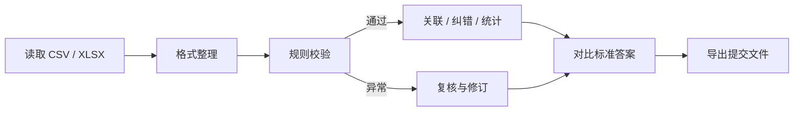
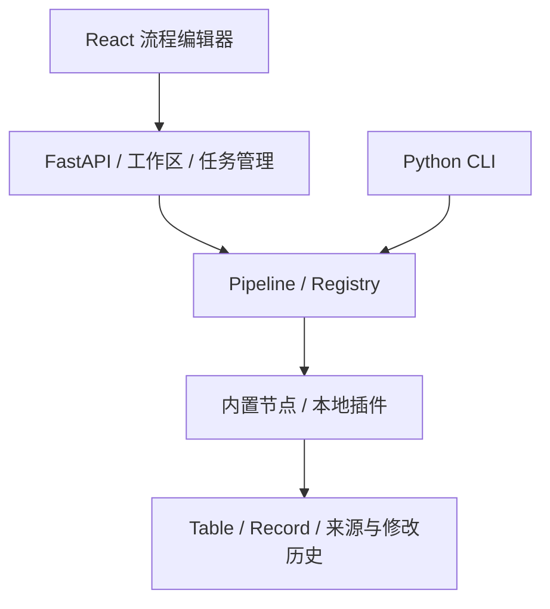

# DataSecurity-All-in-One

**CTF Data Security Workbench · CTF 数据安全处理工作台**


面向 **CTF 数据安全题**的本地数据处理工具，使用 **Python + FastAPI + React + TypeScript** 独立实现。通过画布组合节点，完成 CSV/XLSX 清洗纠错、字段复原、身份证校验、日志与流量提取、编解码、关联统计及提交文件导出。CLI 与网页共用同一套执行内核，处理过程保留数据来源、异常原因和修改记录。

数据在本机处理，无云端账号或外部 AI 服务依赖。当前提供 **56 个内置节点**、可视化插件管理及一个外部插件样例；普通插件通过元数据生成参数表单，无需逐个修改前端。


*截图为自建 6 行纠错演练，100% 是该样本的本地对比结果，不是赛事官方得分。模块库中的 57 包含 56 个内置节点和 1 个外部样例。*

[功能一览](#功能一览) · [处理流程](#处理流程) · [真实题验证](#真实题验证) · [纠错与评分](#纠错与评分) · [插件扩展](#插件扩展) · [技术与结构](#技术与结构) · [部署运行](#部署运行) · [文档与开发](#文档与开发) · [常见问题](#常见问题)

## 功能一览

| 模块 | 当前功能 |
| --- | --- |
| 数据输入 | CSV/TSV、JSON/JSONL、文本日志、XLSX；通过本机 TShark 读取离线明文 HTTP 请求正文 |
| 字段处理 | 选择、重命名、拆分、合并、填空、优先级回填、宽转长、多值拆行、JSON Pointer 提取 |
| 清洗校验 | 空白与 Unicode 整理、正则替换、组合规则、身份证校验码与生日/性别对照、Luhn 校验 |
| 数据复原 | 按规则复原错位字段、字典映射、近似候选、参考表校正、带原值检查的人工修订 |
| 计算分析 | Decimal 表达式、日期处理、筛选、去重、排序、追加、关联、分组统计、时间窗口计数与分组异常 |
| 编解码与密码 | 常见编码、摘要、循环 XOR、RSA 验签与脱敏；部分节点需要可选依赖 |
| 正确率 | 按重复次数比较整行，或按唯一键/行位置对齐逐行、逐格比较；输出差异、缺失、多余和阈值判断 |
| 结果导出 | CSV、JSON/JSONL、XLSX、纯文本；明确控制编码、换行、列顺序和摘要输入内容 |
| 工作区 | 流程保存/导入/重开、撤销重做、所选节点预览、运行记录、全结果搜索、分页、来源与修改追踪 |
| 插件管理 | 导入 `.py`、粘贴源码、从模板创建、启停、重新加载；错误文件独立报告 |

节点参数和边界见 [节点手册](docs/node-catalog.md) 与 [新增节点说明](docs/advanced-nodes.md)。

## 处理流程

例如清洗人员数据时，可以组合“读取 CSV → 格式整理 → 身份证校验 → 关联参考表 → 导出”。校验节点将通过和异常记录送到不同端口，异常分支可继续检查或单独导出。



1. 首页选择示例，或上传数据后新建流程。
2. 从模块库添加节点，连接命名端口，在右侧编辑参数。
3. 选择节点并点击“预览所选”，计算它和所需的上游，查看分支数据与记录追踪。
4. 点击“运行全部”执行输出节点，在“导出结果”下载文件。
5. 保存流程 JSON，后续可在网页重开，也可交给 CLI 复现。

**预览仍计算完整输入**，分页只限制显示条数；`rows.sample` 才会显式抽样。预览跳过输出节点，正式运行才生成提交文件。“导出此分支”可下载完整分支 CSV，不受搜索和分页限制；需要原题指定的编码、CRLF 等格式时，使用配置好的输出节点。

自带基础清洗、通用统计、编码还原、证件一致性、订单调查、参考表纠错和纠错评分示例。快捷键：`Ctrl+S` 保存，`Ctrl+Z` 撤销，`Ctrl+Shift+Z` 重做。

## 真实题验证

已用公开完整原附件运行下列流程。处理逻辑由本项目节点执行，没有导入或运行下载附件中的解题脚本。**附件不随源码重新分发**，复现脚本按固定版本下载并核验 SHA-256。

| 题目与公开来源 | 完整输入 / 处理结果 | 验证范围 |
| --- | --- | --- |
| [广工2025 Data Analysis](https://github.com/GDUTMeow-Challenges/Challenge-Data-Analysis) | 10,000 行错位 CSV，恢复 8 列 | 完整结果摘要与出题人公布 flag 一致 |
| [广工2025 Data Cleaning](https://github.com/GDUTMeow-Challenges/Challenge-DataCleaning) | 2,000 行 CSV 和 RSA 公钥，识别 100 个异常编号 | 计算结果与出题人公布 flag 一致 |
| [广工2025 Data from Log](https://github.com/GDUTMeow-Challenges/Challenge-Data-from-Log) | 34 MB 日志，按公开参考解答口径恢复并脱敏 2,000 行 | 完整结果摘要与出题人公布 flag 一致 |
| [羊城杯2024 data-analy1](https://github.com/CTF-Archives/2024-YCB-Undergraduate) | 10,000 行原始乱序 CSV，保留中文表头 | 原附 10 行示例逐格一致；与广工复用题为同一数据，不另计独立题 |
| [羊城杯2024 data-analy2](https://github.com/CTF-Archives/2024-YCB-Undergraduate) | 提取 8,000 条请求，输出题目要求的 294 条垃圾数据 | 独立规则核对一致；没有官方答案或正确率 |
| [浙江2024决赛 classify1](https://github.com/CTF-Archives/2024-zjsdxs-Finals) | 20,000 行 CSV 全部分类为姓名、身份证、手机号 | 完整原 CSV 独立核对一致；没有官方正确率 |
| [浙江2024决赛 classify2](https://github.com/CTF-Archives/2024-zjsdxs-Finals) | 5,231 条请求正文，输出 4,221 条校验通过的记录 | 独立正文扫描与规则核对一致；没有官方正确率 |

没有连接已结束赛事的在线评分平台。“通过格式校验”不等于“答案正确”。浙江2025纠错 CSV、羊城杯2025原始 XLSX 尚未取得，本项目没有将自造样本计作这些原题的实测。

完成下文依赖安装后，在项目根目录执行：

```powershell
# 首次下载并运行；以后去掉 --fetch 即可离线重跑
python scripts/real_ctf.py --fetch
python scripts/contest_round2.py --fetch

# 核对第二批流程的 Web 正式运行、完整下载与 CLI 文件是否一致
python scripts/verify_contest_web.py
```

第二批流量题需要 TShark 位于 `PATH`。附件、提交文件、来源清单与验证报告保存在 `work/`。Web 首页搜索“真实题”“浙江2024”或“羊城杯2024”可打开对应流程。详细规则差异、预期答案和证据范围见 [首次原题实测](docs/real-ctf.md) 与 [浙江/羊城杯实测](docs/contest-round2.md)。

## 纠错与评分

三个节点分开承担候选生成、确认修改和结果比较，便于逐步检查。

| 节点 | 用法与行为 |
| --- | --- |
| `tables.fuzzy_lookup` | 按字典和编辑距离生成候选，可按组限制字典；开启自动应用时只采用唯一最优候选，歧义与未命中进入复核分支 |
| `table.patch` | 通过唯一键、字段、原值、新值和理由修订；同一源记录的修订全部检查通过后才应用，原值不符等冲突另行输出 |
| `tables.score` | 整行重复次数比较，或按唯一键/位置对齐；可选行/格评分，输出摘要、字段统计、差异、缺失与多余记录 |

multiset 模式保留重复次数，采用以下口径：

```text
正确率 = 正确行数 / (标准答案行数 + 多余行数)
```

这与公开 [DSFileChecker](https://github.com/GamerNoTitle/DSFileChecker) 的该项数学口径一致；该评分器属于 ADCTF 出题人的项目，**不能直接当作浙江省赛或羊城杯的官方评分器**。按键逐格比较采用另一种明确口径，错误格不会再次计作多余行，具体参数见 [纠错与正确率](docs/correction.md)。

首页搜索“字典纠错”可打开自建 6 行演练：先比较原数据，再自动修正 2 处唯一候选，应用 3 行人工修订，最后评分并导出 XLSX。它用于理解执行和追踪，包含歧义、空值、未命中与前导零编号。

## 插件扩展

网页顶部打开“插件”，可以导入 Python 文件、粘贴源码或选模板创建。修改后重新加载，普通插件会自动出现在模块库；无需重启服务或手工注册前端组件。

| 接口 | 职责 |
| --- | --- |
| `PluginSpec` | 唯一 ID、名称、分类、输入输出端口、参数与版本 |
| `check_config` | 校验参数，不读取附件 |
| `run` | 接收输入表、配置与运行上下文，返回声明的输出分支 |
| `PLUGINS` | 声明当前文件导出的插件类 |

建议从 [plugins/add_prefix.py](plugins/add_prefix.py) 入手，再看 [完整校验插件教程](docs/plugin-development.md) 和 [界面插件管理](docs/plugin-manager.md)。Web 自动扫描工作区 `plugins/` 的直接 `.py` 文件，CLI 可用 `--plugin-dir plugins` 指定。

插件是可信本地 Python，拥有当前进程权限，没有执行沙箱。处理循环应调用 `context.check_cancelled()`；修改记录使用 `with_updates` 等接口，以保留来源和变更依据。

## 技术与结构

| 项目 | 配置或版本 |
| --- | --- |
| Python | 3.11+，纯 CLI 的 CSV/JSON 和多数节点仅使用标准库 |
| 本地服务 | FastAPI、Uvicorn，默认 `127.0.0.1:8765` |
| 前端 | React 19、TypeScript 7、React Flow、Vite 8；精确版本见 `frontend/package-lock.json` |
| XLSX | openpyxl，单元格按字符串处理，读取不执行公式 |
| 密码扩展 | cryptography，可选安装 |
| 流量提取 | 本机 TShark，仅处理离线明文 HTTP 请求正文 |
| 持久化 | 流程 JSON、输入附件和导出文件；不需要数据库 |



```text
DataSecurity-All-in-One/
├── datasecurity/
│   ├── core/                 # 表格模型、插件契约、注册表、执行器
│   ├── builtin/              # 输入、清洗、校验、纠错、统计、导出节点
│   ├── web/                  # FastAPI、工作区、任务与插件管理
│   └── cli.py                # 命令行入口
├── frontend/
│   ├── src/                  # 画布、参数表单、预览、评分与文档界面
│   └── tests/                # 前端逻辑测试
├── plugins/                  # 外部插件样例
├── examples/                 # 流程 JSON 与虚构小样本
├── scripts/                  # 固定来源的真实题复现与 Web 核对
├── tests/                    # 内核、节点、Web 与原附件回归
├── docs/                     # 代码导读、架构、插件、节点与题目文档
└── pyproject.toml            # Python 依赖与入口配置
```

执行器只读取流程中的 `nodes`，不读取画布位置等 `ui` 数据。配置和连线校验完成后按依赖顺序执行；所有输入/处理节点成功后才执行输出。单元格保持字符串，避免把 `0001`、空字符串与 `NULL` 自动混同。详见 [架构与边界](docs/architecture.md)。

## 部署运行

### 1. 准备环境

安装 **Python 3.11+** 和 **Node.js 24 LTS**（兼容 Node 22.18+），并准备 Git。以下以 Windows PowerShell 为例：

```powershell
git clone https://github.com/MetaViii/DataSecurity-All-in-One.git
Set-Location DataSecurity-All-in-One
python --version
node --version
npm --version
```

### 2. 安装依赖并构建前端

```powershell
python -m venv .venv
.\.venv\Scripts\Activate.ps1
python -m pip install -e ".[web,test,crypto]"
Set-Location frontend
npm ci
npm run build
Set-Location ..
```

Web/XLSX 使用 `web` 依赖，测试使用 `test`，RSA 等节点使用 `crypto`。不需要对应能力时可省略可选项。纯 CLI 可只执行 `python -m pip install -e .`。前端构建产物与依赖目录不提交到仓库，新环境需要执行上述构建。

### 3. 启动

```powershell
python -m datasecurity serve
```

浏览器访问 `http://127.0.0.1:8765`，停止服务按 `Ctrl+C`。端口冲突可加 `--port 8766`，不自动打开浏览器可加 `--no-browser`。默认以当前目录为工作区，请在项目根目录启动，或用 `--workspace "项目绝对路径"` 明确指定。

需要流量节点时另行安装 Wireshark/TShark，将 TShark 所在目录加入 `PATH`，在新终端执行 `tshark --version` 确认。其他流程不依赖 TShark。

### 4. CLI 运行

```powershell
python -m datasecurity plugins
python -m datasecurity plugins --id tables.join
python -m datasecurity validate examples/generic_cleaning.json
python -m datasecurity run examples/clean_people.json --preview --limit 2
python -m datasecurity run examples/generic_cleaning.json
python -m datasecurity run examples/local_plugin.json --preview
```

CLI 的输入输出路径默认相对流程 JSON 所在目录。Web 保存/下载的流程使用工作区路径，拿到 CLI 运行时指定基准目录：

```powershell
python -m datasecurity run your-flow.json --base-dir . --plugin-dir plugins --preview
```

### 5. 工作区文件

| 路径 | 用途 |
| --- | --- |
| `examples/data/` | 随源码提供的虚构小样本 |
| `work/uploads/` | Web 上传附件，单文件最多 128 MiB |
| `work/projects/` | 正式保存的流程 JSON，带修订号 |
| `work/exports/<运行ID>/` | Web 每次正式运行的独立结果目录 |
| `work/real-ctf/`、`work/contest-round2/` | 原题脚本下载的附件、来源记录与生成结果 |
| `plugins/` | 可信本地插件源码 |
| `frontend/dist/` | 本机前端构建产物 |

`work/` 不进版本控制，输入和导出文件不会自动清理。浏览器缓存当前流程草稿，不缓存表格数据。迁移流程时需要一并复制其附件与插件；JSON 本身不包含这些文件。

## 文档与开发

| 文档 | 内容 |
| --- | --- |
| [代码导读](docs/code-tour.md) | 推荐审计顺序、一次点击的执行全链路、状态流转与练习 |
| [架构与边界](docs/architecture.md) | 数据模型、执行协议、文件策略、并发与限制 |
| [插件开发](docs/plugin-development.md) / [插件管理](docs/plugin-manager.md) | 完整插件样例、身份证校验的拆法、前端自动接入与重载 |
| [节点手册](docs/node-catalog.md) / [新增节点](docs/advanced-nodes.md) | 参数、输入输出和容易混淆的语义 |
| [工作台操作](docs/workbench-guide.md) / [界面说明](docs/ui-notes.md) | 工作区、连线、预览、追踪与界面实现 |
| [小样本演练](docs/ctf-recipes.md) | 自造数据的处理思路与预期结果 |
| [首次实测](docs/real-ctf.md) / [浙江与羊城杯](docs/contest-round2.md) | 原附件来源、完整结果、规则差异与验证范围 |
| [纠错与正确率](docs/correction.md) | 候选、人工修订、行/格评分及审计示例 |
| [后续计划](docs/TODO.md) | 已完成与待补能力 |

前端开发使用两个终端：后端运行 `python -m datasecurity serve --no-browser`；另一个终端进入 `frontend/`，执行 `npm run dev` 后访问 `http://127.0.0.1:5173`。Vite 将 `/api` 代理到 8765。修改 Python 服务代码需重启，普通外部插件可从界面重新加载。

验证命令：

```powershell
python -m unittest discover -v
Set-Location frontend
npm test
npm run build
npm run format:check
```

0.5.0 本机验证为 **90 项 Python 测试、17 项前端测试通过**，包含已下载完整原附件的回归；生产构建和前端格式检查通过。4 条第二批原附件流程的 Web 下载与 CLI 文件逐字节一致。新环境未下载原附件或缺少可选工具时，对应测试会跳过，请同时检查测试输出中的 skip。

## 常见问题

| 现象 | 排查方法 |
| --- | --- |
| 提示缺少 Web 或 XLSX 依赖 | 在同一个 Python 环境运行 `python -m pip install -e ".[web]"` |
| 页面无法打开或缺少前端产物 | 先在 `frontend/` 执行 `npm ci` 和 `npm run build`，再启动服务 |
| PowerShell 无法激活虚拟环境 | 可直接使用 `.\.venv\Scripts\python.exe` 替代后续命令中的 `python` |
| 输入文件不存在 | 检查 Web 工作区、CLI 的流程目录基准和 `--base-dir`；真实题先运行下载脚本 |
| TShark 不存在 | 安装并加入 `PATH`，新终端检查 `tshark --version`，然后重启服务 |
| 预览没有生成文件 | 预览跳过输出节点；点击“运行全部”后查看导出结果 |
| 数据只显示一页 | 页面使用分页；搜索覆盖完整结果，“导出此分支”下载完整分支 |
| 规则全部通过，但比赛答案不对 | 核对题目规则、表头、行序、重复次数、编码、换行与摘要对象；规则通过率不是正确率 |
| 新插件没有出现 | 检查 `PLUGINS`、唯一 ID 和错误提示，确认 `.py` 位于工作区 `plugins/`，然后重新加载 |
| 旧结果或下载链接失效 | 修改配置后重新运行；服务只保留近期结果，已经生成的文件仍在 `work/exports/` |

当前数据全量驻留内存、节点串行执行，适合本地单人审题与中小附件；未实现流式处理或分布式调度。默认仅监听本机，不应直接作为多人公网服务部署。取消为协作式检查，无法强制中断任意第三方插件。单文件输出使用临时文件替换，多个输出间没有统一事务。

源 Excel 已丢失的数字精度无法恢复。PCAP 节点仅覆盖离线明文 HTTP 请求正文；SQL dump、数据库直连、通用自动推断修复和未知赛事评分器适配尚未实现。
